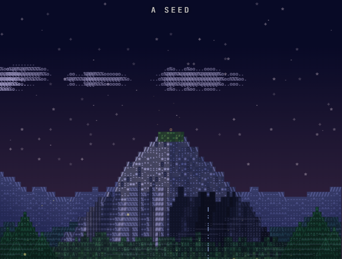
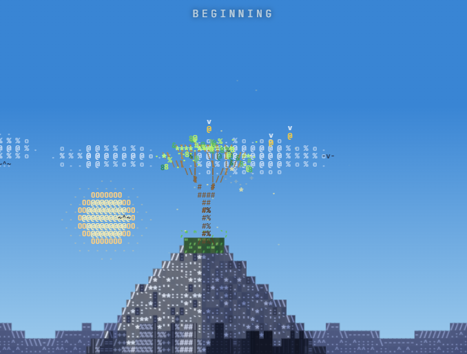

# Summit: An ASCII Animation

Summit is a single-file canvas animation in which an ASCII mountain scene grows into a cosmic journey and returns home.

## The Journey

- A seed sprouts into a tree, blossoms, and grows an apple.
- The apple falls into a black hole and is pulled apart into a spiral.
- A Big Bang expands into the Milky Way, the solar system, and Earth.
- The camera dives back to the mountain, completing the loop.

## Run

Open `Ascii_animation.html` in a modern browser. No build step or dependencies are required. Choose **Begin silent** or **Begin with sound** to start.

## Controls

Pause or resume, change playback speed, jump between scenes, or scrub the timeline. Sound, volume, captions, and Calm mode can be adjusted while the animation plays. **Save MP4** records a full loop when the browser supports recording; otherwise the page offers WebM when available.

The animation includes bright flashes and camera shake. Calm mode softens these effects.